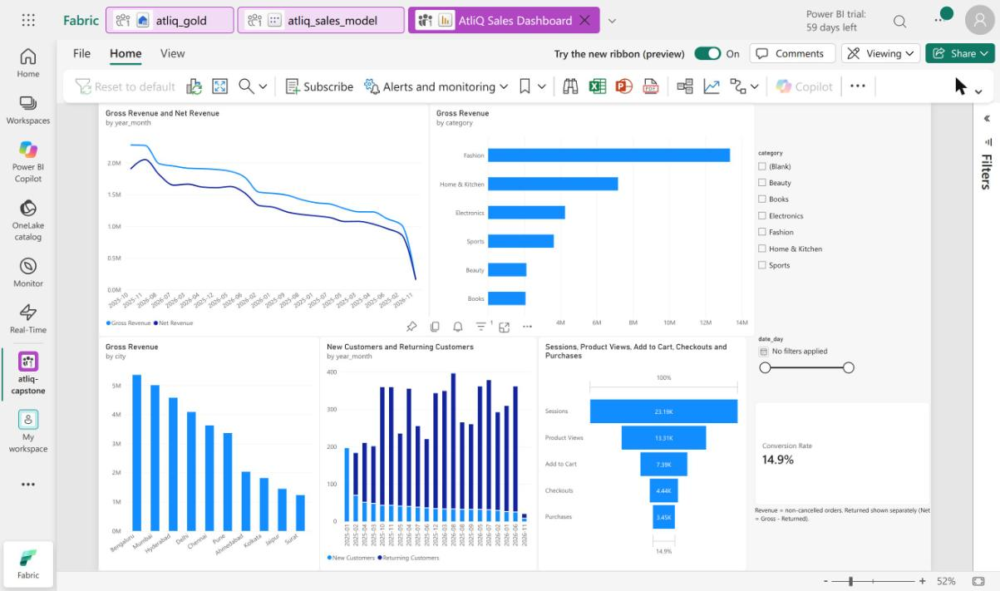

# AtliQ Commerce — Batch Lakehouse (Capstone Phase 1)

A nightly batch pipeline that copies AtliQ's operational (OLTP) data into a separate analytics
lakehouse, cleans it, and models it into a star schema, so analytics never slows the live shop.

```
Azure SQL (OLTP) ──ADF──> Bronze (raw Parquet/CSV/JSON) ──Databricks──> Silver (clean, MERGE)
                                                                │
                                                     dbt ──> Gold (star schema + web funnel)
                                                                │
                                                      nightly job 01:00 IST + run audit
```

## Status

| Milestone | Result | Evidence |
|---|---|---|
| M1 OLTP in Azure SQL + simulator | 7 scripts loaded, counts 1008 / 60 / 10000 / 23155 / 8320 | `docs/azure_sql_counts.png` |
| M2 ADF metadata-driven pipeline | One generic pipeline, 5 tables + 2 CSVs + 184 clickstream files, watermarks advanced | `adf/arm_template.json`, `docs/adf_run.txt` |
| M3 Bronze → Silver (cleaning, dq_log, MERGE, quarantine) | All 28 §7.7 checkpoints match | `docs/dq_report.md` |
| M4 Gold with dbt (5 tables, 7 views, 37 tests) | PASS=49 WARN=0 ERROR=0 | `atliq_gold/` |
| M5 Nightly job, schedule, failure email, idempotency | 01:00 IST schedule fired on its own; two runs identical; first ADF batch merged with no duplicates | `jobs/nightly_job.json`, `docs/nightly_job.jpg`, `docs/idempotency_proof.jpg`, `docs/incremental_run.txt` |
| M6 Fabric dashboard | Lakehouse `atliq_gold` + Direct Lake semantic model + report: revenue trend, top categories, top cities, new vs returning, funnel, date/category slicers | `docs/fabric_dashboard.jpg`, `fabric/model.tmdl` |
| M7 CI/CD (GitHub Actions dbt build) | `dbt build --target ci` into throwaway schema `atliq.ci` | `.github/workflows/ci.yml` |

### Why the platform is split (hybrid)

- **Azure** (resource group `rg-atliq-capstone`): Azure SQL (OLTP), ADLS Gen2 (`lakehouse` container),
  Azure Data Factory. ADF lands Bronze in ADLS exactly as the guide describes.
- **Databricks Free Edition**: Silver, dbt Gold and the nightly job (Unity Catalog, serverless,
  SQL warehouse). My Azure Databricks trial had expired, and Free Edition cannot attach an ADLS
  external location, so `tools/adf_pull.sh` carries each night's ADF output
  (`bronze/<table>/ingest_date=<date>/`) into the Unity Catalog volume `atliq.raw.landing` with the
  same layout. Nothing downstream of Bronze changes; on a full Azure Databricks workspace the notebook
  would read `abfss://lakehouse@<account>.dfs.core.windows.net/bronze` directly.
- The very first Bronze load (before Azure was available) was built from the seed files by
  `tools/seed_to_bronze.py` as batch `ingest_date=2026-08-31`; the §7.7 checkpoints were matched on it.

### What is automated and what is not

| Step | How it runs |
|---|---|
| Databricks nightly job (Silver, dbt Gold, run audit) | Scheduled at 01:00 IST with a failure email; the schedule fired on its own (`docs/nightly_job.jpg`) |
| ADF `pl_nightly_ingest` | Run on demand by `tools/adf_up.sh`; no ADF schedule trigger was added, to keep Azure cost minimal during the build |
| ADF output to Databricks (`tools/adf_pull.sh`) | Manual: Free Edition cannot read ADLS, so this copy is the one step a person runs |

On a full Azure Databricks workspace the chain would be fully automatic: an ADF schedule trigger at about 00:30 IST
(or an ADF "Databricks notebook" activity after the copies), with the notebook reading
`abfss://lakehouse@<account>.dfs.core.windows.net/bronze` directly, so `adf_pull.sh` would not be needed.

## The nightly sync, end to end

```
Azure SQL ──ADF pl_nightly_ingest──> ADLS bronze/ ──adf_pull.sh──> UC volume ──job 01:00 IST──> Silver ─dbt─> Gold ─> run_audit
   │  set_run_start_at → lookup etl.control_table → ForEach table:
   │     If incremental: copy rows where <watermark_column> > last_loaded_at → bronze/<t>/ingest_date=<run date>/
   │     else          : copy whole table → bronze/<t>/  (overwrite)
   │     then etl.usp_update_watermark(<t>, run_start_at)   ← only after that copy succeeded
   └─ in parallel: 2 CSVs and 184 clickstream files copied byte-for-byte (Binary, no parsing)
```

`atliq.silver.run_audit` after the first ADF batch (2026-11-14):

| run_date | when | silver orders | items | payments | fact rows | gross revenue |
|---|---|---:|---:|---:|---:|---:|
| 2026-11-13 | manual run 1 | 10,000 | 23,155 | 8,320 | 22,959 | 39,392,719.00 |
| 2026-11-13 | manual run 2 | 10,000 | 23,155 | 8,320 | 22,959 | 39,392,719.00 |
| 2026-11-13 | 01:00 IST scheduled | 10,000 | 23,155 | 8,320 | 22,959 | 39,392,719.00 |
| 2026-11-14 | after ADF batch | 10,020 | 23,203 | 8,341 | 23,007 | 39,556,875.00 |

The 2026-11-14 batch contained all 10,020 orders (first run, watermark 1900-01-01), yet Silver gained
exactly the 20 new orders, and the 5 orders the simulator moved forward were updated in place.
(The revenue here includes Cancelled orders; the §7.7 figure 32,424,661.00 excludes them.)

## Fabric dashboard (M6)



- **Workspace** `atliq-capstone` on a Fabric **F2** capacity in `rg-atliq-capstone` (the free Fabric trial was refused
  for this tenant; the capacity is paused when not in use).
- **Data:** Free Edition cannot expose Gold on ADLS for a OneLake shortcut, so `tools/export_gold.py` exports the five
  Gold tables to Parquet and they are loaded into the Lakehouse `atliq_gold` (same rows as `atliq.gold`).
- **Model:** Direct Lake semantic model `atliq_sales_model`; relationships and measures are in
  [`fabric/model.tmdl`](fabric/model.tmdl) (applied through the TMDL view): fact_sales to dim_customer, dim_product
  and dim_date; fact_web_sessions to dim_date, so the date slicer also filters the funnel.
- **Revenue definition (stated on the dashboard):** Gross = non-cancelled orders; Returned shown separately;
  Net = Gross − Returned. Gross 32,588,817 = the §7.7 32,424,661 plus exactly the 2026-11-14 ADF batch.
- **Funnel:** 23,193 sessions → 13,309 product views → 7,391 add to cart → 4,442 checkouts → 3,446 purchases,
  conversion 14.9% (matches §7.7).

## Repo layout

| Path | What |
|---|---|
| `sql/` | OLTP schema, seed data, `etl.control_table` + watermark procedure (starter package) |
| `python/daily_order_simulator.py` | Adds new/updated orders to Azure SQL (starter package) |
| `csv/`, `clickstream/` | Supplier price list, marketing spend, web clickstream JSON (starter package) |
| `tools/seed_to_bronze.py` | Seed SQL → typed Parquet Bronze, partitioned by `ingest_date` |
| `tools/upload.py` | Uploads Bronze to `/Volumes/atliq/raw/landing/bronze` |
| `tools/push_notebooks.py` | Imports the notebooks + dbt project into the workspace |
| `tools/make_job.py` | Creates the nightly job and exports `jobs/nightly_job.json` |
| `tools/azure_up.sh`, `tools/load_oltp.py` | Azure SQL + ADLS setup and OLTP load with count checks |
| `adf/arm_template.json` | The whole ADF factory: linked services, parameterised datasets, `pl_nightly_ingest` |
| `tools/adf_up.sh`, `tools/adf_pull.sh` | Deploy + run the pipeline; carry its Bronze output into Databricks |
| `tools/run_job.py` | Trigger the nightly job and print `run_audit` |
| `tools/export_gold.py`, `fabric/model.tmdl` | Gold → Parquet for the Fabric Lakehouse; semantic-model relationships + DAX measures |
| `.github/workflows/ci.yml` | dbt CI on every pull request |
| `databricks/01_bronze_to_silver.py` | Cleaning rules, `dq_log`, MERGE into Silver, quiet-night guard |
| `databricks/02_checkpoints.py` | The 28 §7.7 checkpoint queries |
| `databricks/03_run_audit.py` | Appends one row per run to `atliq.silver.run_audit` |
| `atliq_gold/` | dbt project: staging views, Gold star schema, tests |
| `jobs/nightly_job.json` | Exported job definition (user email masked) |
| `docs/` | Job run and idempotency screenshots |

## Run it

Needs [uv](https://docs.astral.sh/uv/). Copy `.env.example` to `.env` and fill in the workspace values.

```bash
uv sync
bash tools/azure_up.sh              # resource group, Azure SQL (Basic), ADLS, budget alert
uv run tools/load_oltp.py           # 7 OLTP scripts + count check
uv run python/daily_order_simulator.py --orders 20 --update-existing 5
bash tools/adf_up.sh                # deploy + run the ADF pipeline
uv run tools/push_notebooks.py      # notebooks + dbt project into the workspace
uv run tools/make_job.py            # create the nightly job
bash tools/adf_pull.sh              # tonight's Bronze -> UC volume
uv run tools/run_job.py             # run the job now, print run_audit
cd atliq_gold && uv run --env-file ../.env dbt build   # dbt locally
```
`python/.env` (Azure SQL) and `.env` (Databricks) are gitignored; copy the `.env.example` files.

## Key results (checkpoints, §7.7)

- Customers 1,000 real in 10 cities; products 60 in 6 categories; orders 9,961 after test-order removal.
- `fact_sales` 22,959 rows. Payments 8,183 totalling 32,424,661.00 = gross revenue of non-cancelled orders.
- Returned 4,574,944 → net 27,849,717.
- Clickstream: 426 bad events quarantined, 23,193 sessions; funnel 13,309 → 7,391 → 4,442 → 3,446.

## Idempotency

Silver uses `MERGE` on business keys and skips a night with no new Bronze batch
(the "quiet night" guard); Gold is rebuilt by dbt. Two consecutive job runs give identical
row counts and revenue (see `docs/idempotency_proof.jpg` and `atliq.silver.run_audit`).

## Data quality

Every cleaning rule logs the rows it touched to `atliq.silver.dq_log`; the full report with the
§7.7 comparison is in [`docs/dq_report.md`](docs/dq_report.md). Unknown text variants become NULL
and fail a dbt test instead of disappearing silently.

## Architecture write-up

[`docs/architecture.md`](docs/architecture.md): why OLTP and OLAP are split, the control table and
watermarks, quiet nights, and idempotency.

## Cost and clean-up

Everything on Azure lives in `rg-atliq-capstone` (SQL Basic ≈ $5/month, ADLS and ADF pennies, Fabric F2 ≈ $0.36/hour only while resumed),
with a ₹1,500 budget alert. Deleting that one resource group removes it all.

## Secrets

No secrets are committed. `.env` and `python/.env` are gitignored; dbt's `profiles.yml` reads
only `env_var()`; the job export masks the user email.
